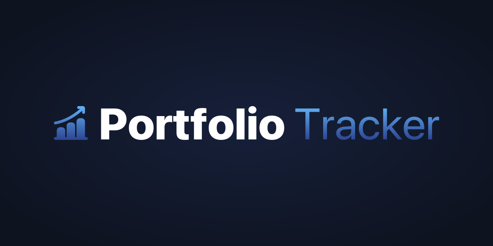
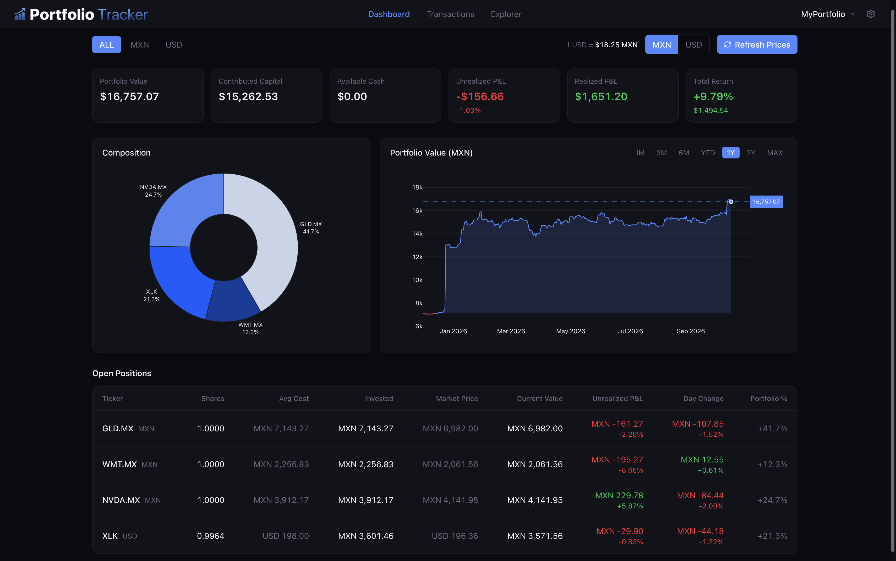
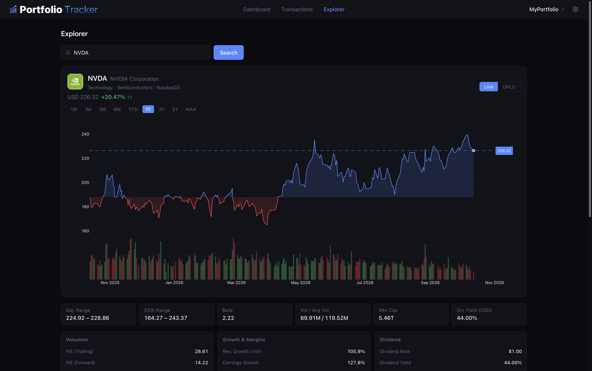
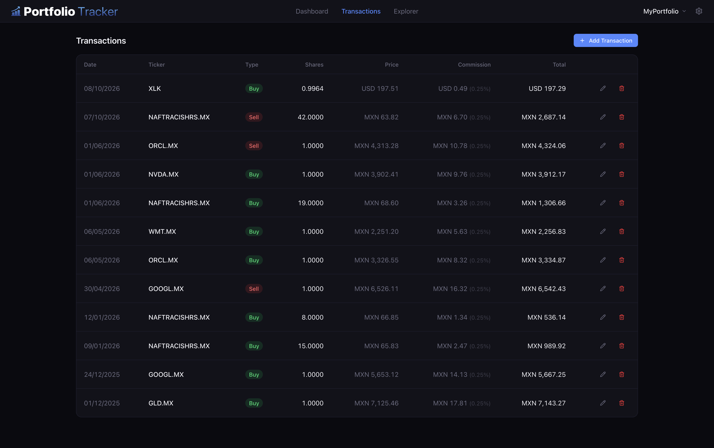

<div align="center">
  

  <p>A self-hosted investment portfolio dashboard for the Mexican (BMV) and American (NYSE/NASDAQ) markets.</p>

  
  
  
  
  
  
</div>

---

## Features

- **Dashboard** — Portfolio value, contributed capital, unrealized/realized P&L, and total return KPIs. Donut composition chart and open positions table with weighted average cost basis.
- **Performance** — Portfolio value over time, Time-Weighted Return (TWR) chart, and risk metrics (volatility, max drawdown, Sharpe ratio).
- **Explorer** — Search any ticker to view interactive price history (line or candlestick), analyst targets & recommendations, fundamentals, and company info. Company logos powered by Logo.dev.
- **Transactions** — Full transaction history with buy/sell tracking, commission support, and inline edit/delete.
- **Settings** — Dark/light theme, accent color picker, pie chart color palette toggle, and global font size slider.

## Screenshots

<div align="center">
  
  <p><em>Dashboard — portfolio value, P&L, and positions table</em></p>

  
  <p><em>Explorer — price history, analyst data, and fundamentals</em></p>

  
  <p><em>Transactions — full history with edit and delete</em></p>
</div>

## Tech Stack

| Layer | Technology |
|---|---|
| Backend | Python 3.11+, FastAPI, SQLAlchemy, SQLite |
| Frontend | React 19 + TypeScript, Vite |
| Styling | Tailwind CSS v4 + shadcn/ui |
| Charts | react-plotly.js |
| Market Data | yfinance (free, ~15 min delay) |
| Exchange Rate | Banxico SIE REST API |
| State | TanStack Query v5 + Zustand v5 |
| Routing | React Router v7 |

## Prerequisites

- Python 3.11+
- Node.js 18+
- A free [Banxico SIE API token](https://www.banxico.org.mx/SieAPIRest/service/v1/token)
- A free [Logo.dev](https://logo.dev) CDN publishable key (optional — for company logos in Explorer)

## Setup

### 1. Clone the repository

```bash
git clone https://github.com/luisejdm/portfolio-tracker.git
cd portfolio-tracker
```

### 2. Backend

```bash
cd backend
python -m venv venv
source venv/bin/activate        # Windows: venv\Scripts\activate
pip install -r requirements.txt
cp ../.env.example .env         # then add your BANXICO_TOKEN
alembic upgrade head            # creates portfolio.db
```

### 3. Frontend

```bash
cd frontend
npm install
cp .env.example .env            # then add your VITE_LOGO_DEV_TOKEN
```

### 4. Run

From the project root:

```bash
npm install
npm run dev
```

This starts both the backend (port 8000) and frontend (port 5173) concurrently. Open [http://localhost:5173](http://localhost:5173) in your browser.

## Environment Variables

**`backend/.env`**
```
BANXICO_TOKEN=your_token_here
```

**`frontend/.env`**
```
VITE_LOGO_DEV_TOKEN=pk_your_token_here
```

## Currency Support

- Tickers ending in `.MX` are treated as **MXN** (BMV)
- All other tickers are treated as **USD** (NYSE/NASDAQ)
- Live USD/MXN exchange rate fetched from Banxico SIE API
- Toggle between MXN and USD display across the entire dashboard

## Cost Basis Method

Uses **Weighted Average Cost** (Costo Promedio Ponderado). Commission percentages are factored into the cost basis and P&L calculations automatically.

## Limitations

- **Long positions only** — short selling is not supported.
- Market data has an ~15 min delay via yfinance (free tier).

## License

[MIT](LICENSE)
